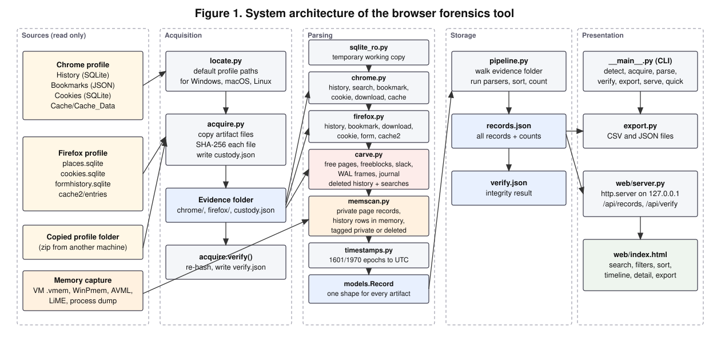
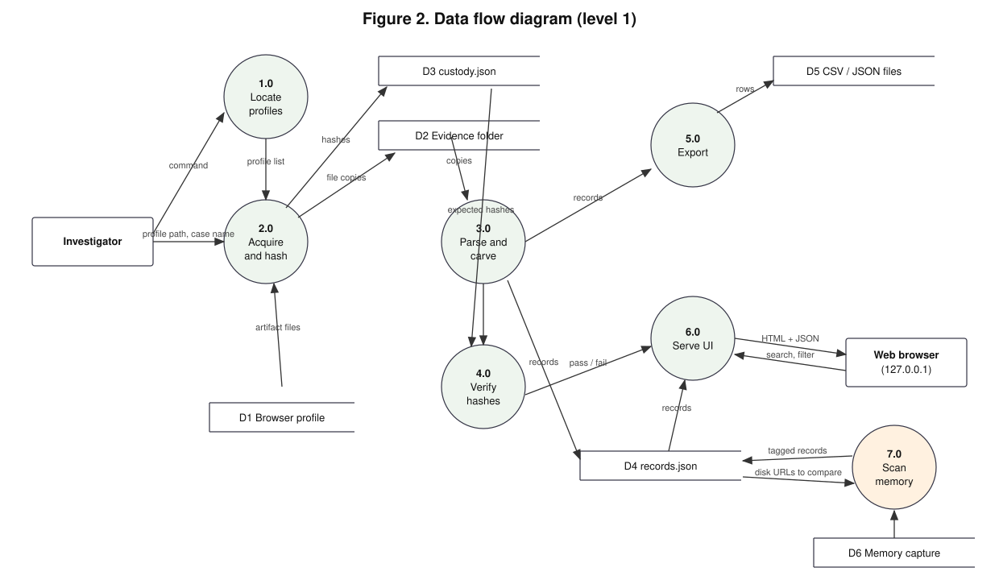
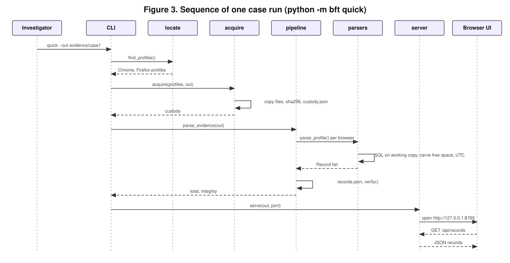
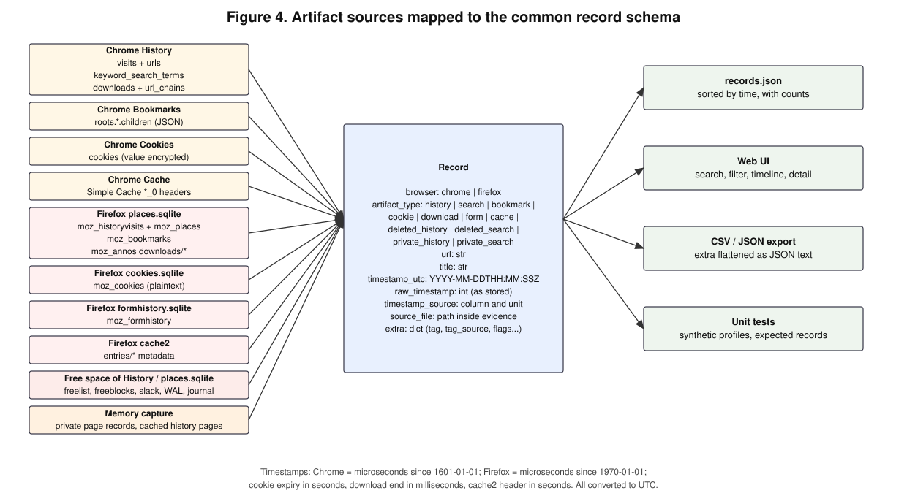

# Web Browser Forensics Tool: Architecture and Design

## 1. Overview

The tool is a pipeline with five stages: sources, acquisition, parsing, storage and presentation. Each stage is one or two Python modules with a single responsibility, so the two team members could build and test their parts independently against an agreed record schema.

## 2. Design principles

1. Evidence is read only. Acquisition copies files out of the profile and records their SHA-256. Parsing opens a temporary copy of each evidence file, never the evidence file itself, and re-verifies the hashes afterwards. Cache folders are recorded with a hash for every file and one over the list, so a changed, missing or added cache file is caught by name.
2. One record shape. Every artifact from either browser becomes a `Record` with the same nine fields, so search, filtering, timeline, export and tests all work on one structure.
3. Timestamps are explicit. Each record stores the UTC value, the raw stored value and the name of the column and unit it came from, so a reader can check the conversion.
4. No dependencies. The tool uses only the Python standard library (sqlite3, hashlib, json, struct, http.server), so it runs the same on Windows, macOS and Linux. The one optional package, pywebview, only shows the interface in its own window; it is bundled into the Windows `.exe`, and without it the interface opens in the default browser.
5. Local only. The web interface binds to 127.0.0.1. Every request must name 127.0.0.1 or localhost on the tool's own port as its host, and every action (capture, scan, demo) must also carry a custom header and a JSON body, which a web page on another site cannot send without the tool's permission. A site the examiner happens to visit can therefore neither read the records nor start a capture. Capture only accepts profiles the tool found itself, and scan only accepts memory files it found itself or matched to a dropped file.

## 3. Data flow

Process 1.0 (locate) finds profile folders using the known default paths for the current operating system. Process 2.0 (acquire) copies the artifact files into the evidence folder (D2) and writes the custody log (D3). Process 3.0 (parse) reads the evidence copies and produces records (D4). Process 4.0 (verify) recomputes the hashes and compares them to D3. Processes 5.0 and 6.0 present the records as files or in the browser.

## 4. Sequence of a run

The `quick` command chains the steps; `acquire`, `parse`, `verify`, `export` and `serve` can also be run one at a time, which is how the tool is used against evidence copied from another machine.

## 5. Record schema

| Field | Meaning |
|---|---|
| browser | `chrome` or `firefox` |
| artifact_type | `history`, `search`, `bookmark`, `cookie`, `download`, `form`, `cache`, `deleted_history`, `deleted_search`, `private_history`, `private_search` |
| url | the URL, host (cookies) or cache key |
| title | page title, bookmark name, cookie name, download target, form value or response status |
| timestamp_utc | ISO 8601 UTC, or null when the source has no timestamp |
| raw_timestamp | the integer exactly as stored by the browser |
| timestamp_source | the table, column and unit, for example `visits.visit_time (us since 1601)` |
| source_file | path of the evidence file the record came from |
| extra | artifact-specific fields: transition type, folder path, cookie flags, download size and state, cache size; for deleted and private records `tag` (`deleted` or `private`) and `tag_source`, the evidence shown on hover |

## 6. Modules

| Module | Responsibility | Owner |
|---|---|---|
| `bft/models.py` | `Record` and `Profile` dataclasses | Ayesha |
| `bft/timestamps.py` | Chrome epoch, Firefox epoch, seconds and milliseconds to UTC | Ayesha |
| `bft/locate.py` | Default profile and cache paths for three operating systems | Ayesha |
| `bft/acquire.py` | Copy, hash, custody log, verify | Ayesha |
| `bft/sqlite_ro.py` | Temporary working copy of a SQLite file, column discovery | Ayesha |
| `bft/chrome.py` | Chrome parsers | Ayesha |
| `bft/firefox.py` | Firefox parsers | teammate |
| `bft/carve.py` | Deleted-record recovery from SQLite free space, WAL and journal | Ayesha |
| `bft/memscan.py` | Browser artifacts in a memory capture, compared with disk evidence | Ayesha |
| `bft/pipeline.py` | Evidence folder to `records.json` | Ayesha |
| `bft/export.py` | CSV and JSON writers | Ayesha |
| `bft/__main__.py` | Command line interface | Ayesha |
| `bft/web/` | HTTP server (cases, background tasks for capture, scan and the demo, snapshot discovery, request guard) and the single-page interface (home, capture, memory snapshot, case views) | teammate |
| `packaging/` | PyInstaller entry point and build script for the app window and `BrowserForensics.exe` | Ayesha |
| `tests/` | Synthetic profiles and unit tests | both |
| `tools/make_demo_evidence.py` | Fictional scenario evidence set for demos | teammate |

## 7. Deleted-record recovery

When a row is deleted, SQLite usually does not erase its bytes straight away. The old bytes can survive in five places, and `carve.py` scans each one:

| Place | What it is |
|---|---|
| Freelist pages | whole pages no longer used by any table |
| Freeblocks | gaps inside a live page where a deleted row used to be; the first 4 bytes are overwritten by the gap's own header |
| Unallocated space | the area between a page's cell pointers and its first cell, which can hold rows left over after deletes or page splits |
| WAL frames | older copies of pages in the write-ahead log (`-wal`), including stale frames from earlier transactions |
| Main-file pages superseded by WAL | the pre-deletion copy of a page that a newer WAL frame replaces |
| Rollback journal | original pages saved before a change (`-journal`) |

For every `http(s)://` in those regions the carver searches backwards for a SQLite record header (varint serial types) whose text column starts exactly at that URL and whose length matches. The decoded record must then match the real table layout: a Chrome `urls` row (URL, title, two counters, a timestamp in range) or a `urls_url_index` entry (URL, row id); a Firefox `moz_places` row (URL, title, reversed host equal to the URL's host reversed). URLs still present in the live table are dropped, so only deleted entries are reported. Search terms are taken from the query string of recovered search URLs.

Recovery is opportunistic. If the browser has SQLite's secure delete enabled, freed space is zeroed. If SQLite rebalanced a page after the delete, the old bytes are gone. If the WAL has been checkpointed and later frames overwrote it, older copies are lost.

## 8. Memory as a source of browser artifacts

`memscan.py` reads a memory capture through a memory map, so multi-gigabyte images are not loaded into RAM. It keeps only pages that were visited, and adds a tag only where the bytes prove it:

| What | How | Becomes |
|---|---|---|
| Firefox private-window page records | the origin attribute `^privateBrowsingId=1`, then the site's origin and the full page address, each preceded by its 4-byte length. The page must be on the same site as the origin and the fields must sit next to each other | `private_history` (and `private_search` for a search URL), tagged `private` |
| History rows held in RAM | the carver's record decoder run at each URL, so SQLite pages of `History` or `places.sqlite` in the file cache give back URL, title and timestamp | `deleted_history` (and `deleted_search`), tagged `deleted`, when the same browser's acquired live history does not have the URL and the carver has not already recovered it |
| Every other URL string, 8-bit and UTF-16 | regular expressions over URL characters; host checked, system noise dropped, leftover bytes after the real end folded into the real URL | kept in the audit file only |

Page records carry the address's exact length, so bytes left over from an earlier string after the URL are never read as part of it. The record was identified from a real Firefox capture: on the Kali VM it held the pages opened in the test's private window and none of the scripts, images and tracking calls those pages loaded, although those carry the private stamp elsewhere (an inference from the bytes, not from Firefox's source). Chrome's incognito mode has no marker the tool recognises, so Chrome records are never tagged `private`.

`deleted` from memory needs the browser's profile in the same evidence folder: a URL cannot be called missing without looking. The tags are worked out when records are merged, not when the image is scanned, so acquiring the profile before or after `memscan` gives the same result.

What a capture can hold depends on the state of the machine:

| State | What memory can still hold |
|---|---|
| Private window open, even on a blank page | Good chance of the session: tab back and forward lists, recently closed tabs |
| Private window closed, browser running | Fragments in freed memory, fading as the machine keeps working |
| Browser closed, machine on | Fewer fragments in freed physical memory |
| Machine restarted or off | Nothing in RAM; on Windows possibly fragments in the page file or hibernation file |

The image's SHA-256 is recorded in `custody.json` under `memory_images`. The scan result is written to `memory/<image>.json`: the private page records, the history rows, and the audit list of every URL string with its copies, encodings and offset. Tagged records are merged into `records.json`, and a later `parse` rebuilds them against the current disk evidence.

## 9. Evidence folder layout

    evidence/case1/
      custody.json            acquisition record with SHA-256 per file, including every cache file
      verify.json             result of the last hash check
      records.json            parsed records, including memory results
      memory/<image>.json     page records, history rows and audit URL list of each scan
      chrome/Default/         History, Bookmarks, Network/Cookies, ...
      chrome/Default/_cache/  cache entry files
      firefox/<profile>/      places.sqlite, cookies.sqlite, formhistory.sqlite
      firefox/<profile>/_cache/entries/

## 10. Interface design

One page with four views. **Home** has three actions (Capture the browser, Memory snapshot, Open demo case) and the list of cases. **Capture the browser** first shows what not to do: do not close the browser or its tabs, because closing Firefox rewrites its history file and private windows exist only in memory, and on Windows a running Chrome locks its history file. It then lists the profiles found on this computer with a tick box each, and a Capture now button that copies, hashes and parses them into a new case named by date and time. **Memory snapshot** gives the VMware Fusion and Workstation menu steps, lists the `.vmem` files found in the usual VMware folders with a Scan button, and accepts a dropped memory file. A browser never tells a page where a dropped file is stored, so the tool looks for a file with the same name and size in the VMware, Desktop, Downloads and Documents folders and scans it in place, rather than uploading a copy of several gigabytes. Long tasks run in the background and the page shows each step as it happens.

The **case** view holds the search box, browser, type and tag filters, date range, export buttons and a hash verification button. The main area is either a sortable table or a timeline grouped by day. Clicking a row opens a detail panel on the right with every field of the record, including the raw timestamp and its source, so the examiner can trace any value back to the file it came from. Deleted and private records show a small `deleted` or `private` tag next to their type; hovering over it, or moving keyboard focus to it, shows where the evidence came from. All other rows carry no tag.

## 11. Testing strategy

Unit tests build synthetic Chrome and Firefox profiles with the real table layouts and known values, run the parsers, and compare the records to expected values, including the timestamp conversions. A pipeline test acquires both synthetic profiles, parses them, checks the hash verification passes, then tampers with one file and checks that verification fails. Carving tests create databases, delete known rows, and check that exactly those URLs are recovered with the right titles and timestamps, from free space, from WAL frames, and from main-file pages superseded by the WAL, and that secure delete leaves nothing in freed space. Memory tests build a synthetic capture with Firefox private page records, a resource carrying the private stamp outside a page record, plain URL strings in both encodings, system noise and real SQLite history pages, then check that only the pages are tagged private, that only history rows missing from the same browser's live history are tagged deleted, that nothing is tagged deleted without an acquired profile, that the order of acquire and scan does not matter, and that the image and evidence hashes are unchanged. Each rule of the page-record check was broken on purpose to confirm a test fails. Interface tests start the server on a temporary folder and check the request guard (other hosts, other sites, missing header, folder names that try to leave the evidence folder), a capture of a synthetic profile, finding and scanning a snapshot in place, matching a dropped file, and building the demo case inside the process, as the `.exe` must. The tool is then run on a real profile on each operating system and the record counts are compared with Hindsight (Chrome) and dumpzilla (Firefox).
