# Abstract

Web browsers record a user's online activity in internal databases: visited pages, typed searches, bookmarks, cookies, downloads and cached content. This project delivers a tool that extracts these artifacts from Google Chrome and Mozilla Firefox, preserves the integrity of the original files with SHA-256 hashes, converts the browsers' internal timestamps to UTC, carves the databases' free space, write-ahead log and journal to recover deleted history and search terms, scans memory captures for pages opened in Firefox private windows and for deleted history still cached in RAM, tags each `private` or `deleted` with the evidence behind the tag, and presents the results in a searchable, filterable interface with a timeline view and CSV/JSON export. A home screen captures the browser or scans a VMware snapshot without the command line, and the tool is packaged as a Windows `.exe` that opens in its own window. The tool is written in Python using only the standard library, so it runs unchanged on Windows, macOS and Linux. It was built in stages (plan, design, core, parsers, interface, tests, then deleted-record recovery and memory scanning after three recorded scope changes) and verified with 36 unit tests, a run on a real Chrome profile of about 46,000 records, a memory capture from a real Kali Linux virtual machine, and a fictional case in which the suspect clears their browser history and then uses a private window, and the tool still reconstructs every step.

# 1. Introduction

## 1.1 Problem statement

During an investigation, the browser is often the richest source of evidence about what a person did on a computer. The Windows Forensics lecture lists browser history among the key locations an investigator examines, alongside the registry, recycle bin and link files. However, the data is not stored in a human-readable form. Chrome keeps history in a SQLite database with timestamps counted in microseconds since 1 January 1601. Firefox uses a different SQLite layout with microseconds since 1970. Cookies, bookmarks and cache each use their own files and formats. An investigator needs a tool that collects these files safely, decodes them correctly and presents them in one place.

## 1.2 Objectives

1. Identify where Chrome and Firefox store history, bookmarks, cookies, downloads and cache on Windows, macOS and Linux.
2. Copy those files into an evidence folder and record SHA-256 hashes so integrity can be proven.
3. Parse every artifact type into one common record format with UTC timestamps.
4. Provide a user interface with search, filtering, sorting and a timeline.
5. Export results to CSV and JSON.
6. Run on both team members' machines without installing extra software.
7. Recover deleted history entries and search terms wherever the browser has left them on disk.
8. Find pages opened in private windows, and deleted history that survives only in RAM, in a memory capture, and tag each with the evidence it rests on.

## 1.3 Scope

Covered: Chrome and Firefox desktop profiles; history, search terms, bookmarks, cookies, downloads, Firefox form history, and cache entry metadata; recovery of deleted history and search terms from database free space, WAL and journal; pages opened in Firefox private windows and deleted history rows in memory captures; acquisition from a live profile or a copied folder; a local web interface; export; unit tests.

Not covered: acquiring RAM itself (done with a capture tool or a VM snapshot), general memory analysis such as processes or passwords, decrypting Chrome cookie values, parsing cached file contents, mobile browsers, Safari and Edge.

# 2. Background

## 2.1 Where the artifacts live

| Artifact | Chrome | Firefox |
|---|---|---|
| History and visits | `History` (SQLite): `urls`, `visits` | `places.sqlite`: `moz_places`, `moz_historyvisits` |
| Search terms | `History`: `keyword_search_terms` | typed values in `formhistory.sqlite` |
| Bookmarks | `Bookmarks` (JSON) | `places.sqlite`: `moz_bookmarks` |
| Cookies | `Network/Cookies` (SQLite, values encrypted by the OS) | `cookies.sqlite` (plaintext) |
| Downloads | `History`: `downloads`, `downloads_url_chains` | `places.sqlite`: `moz_annos` with `downloads/*` attributes |
| Cache | `Cache/Cache_Data/*_0` (Simple Cache) | `cache2/entries/*` |

Default profile locations:

| OS | Chrome | Firefox |
|---|---|---|
| Windows | `%LOCALAPPDATA%\Google\Chrome\User Data\Default` | `%APPDATA%\Mozilla\Firefox\Profiles\<id>` |
| macOS | `~/Library/Application Support/Google/Chrome/Default` | `~/Library/Application Support/Firefox/Profiles/<id>` |
| Linux | `~/.config/google-chrome/Default` | `~/.mozilla/firefox/<id>` |

## 2.2 Timestamps

Chrome stores times as microseconds since 1601-01-01 00:00 UTC (the Windows FILETIME epoch, in microseconds). Firefox stores most times as microseconds since 1970-01-01 UTC, but cookie expiry is in seconds, download completion time is in milliseconds, and cache2 headers use seconds. Getting these conversions right is essential: a Chrome value interpreted as a Unix time would be off by 369 years. The tool keeps the raw value next to the converted value so every conversion can be checked.

## 2.3 Forensic principles applied

The course material stresses that evidence must be acquired without alteration and that its integrity must be demonstrable. The tool therefore never opens an original file for writing: it copies the files, hashes them, parses temporary copies, and re-hashes the evidence afterwards. The custody log records who acquired what, from where, on which machine and when.

## 2.4 Deleted history and private browsing

SQLite stores each table as a tree of fixed-size pages. Deleting a row does not normally erase its bytes. The space is marked free and is only overwritten later. Old bytes can therefore survive in:

- **Freelist pages**, whole pages no longer used by any table.
- **Freeblocks**, gaps inside a live page where a deleted row was. Only the first four bytes are overwritten by the gap's own header.
- **Unallocated space**, the area between a page's cell pointers and its first cell, which can still hold rows left over after deletes or page splits.
- **The write-ahead log (WAL)**, which holds newer copies of changed pages. Older frames, and the main-file pages they supersede, can still contain the rows before they were deleted. Firefox uses WAL mode.
- **The rollback journal**, which holds original pages saved before a change.

Two things defeat recovery. SQLite's secure delete option zeroes freed space at the moment of deletion. Page rebalancing after a delete can also rewrite a page and lose the old bytes. Recovery is therefore opportunistic, and an honest tool must say where each recovered record came from.

Private (Firefox) and Incognito (Chrome) windows are designed to keep history, cookies and cache in memory only. Nothing from those sessions is written to the profile folder, so no profile parser, commercial or otherwise, can recover them from it. Traces can survive elsewhere: downloaded files, bookmarks made in the private window, RAM while the window is open, and on Windows the page file and `hiberfil.sys` covered in the Windows Forensics lecture. A memory capture is a snapshot of whatever is still in RAM, not a recording, and programs do not wipe memory they have finished with. What it can hold depends on the state of the machine when it is captured:

| State at capture | What memory can still hold |
|---|---|
| Private window open, even on a blank page | Good chance of the session: tab back and forward lists, recently closed tabs |
| Private window closed, browser running | Fragments in freed memory, fading as the machine keeps working |
| Browser closed, machine on | Fewer fragments in freed physical memory |
| Machine restarted or off | Nothing in RAM; on Windows possibly fragments in the page file or hibernation file |

A full RAM capture is needed for the middle two cases, because freed pages belong to the operating system and are not in a dump of the browser process. Browser engines store many strings as UTF-16, so a scanner must search both 8-bit and UTF-16 text. A bare URL string in memory proves only that the string was there. It could be a link inside a page, a script the page loaded, normal browsing not yet saved, or another program. Firefox, however, marks data that belongs to a private window with the origin attribute `privateBrowsingId=1`, and keeps a small record for each page: the private stamp, the site's origin and the full page address, each preceded by its length. Section 6.9 shows that on a real capture this record held the pages opened in a private window and none of the resources those pages loaded. This was established from the bytes, not from Firefox's source. Chrome's incognito mode has no marker the tool recognises.

## 2.5 Collecting browser evidence at a scene

RFC 3227 sets the order of collection: the evidence that disappears fastest is collected first. For a running computer with a browser open:

1. Do not touch the browser. Photograph the screen.
2. Capture full RAM with a trusted capture tool run from the examiner's own media (WinPmem or DumpIt on Windows, AVML or LiME on Linux). In this project's lab, a VMware snapshot of the suspect VM provides the same image from the host.
3. Copy the browser profiles while the browser is still running (`bft acquire`). Closing Firefox checkpoints its WAL, which can overwrite exactly the deleted rows the carver recovers, and Chrome writes pending changes on exit. On Windows a running Chrome blocks copying its History file, so examiners image the disk or use a Volume Shadow Copy.
4. Only then decide how to shut the machine down.
5. Analyse the copies on the examiner's machine.

Every program run on the live machine, including the capture tool, changes its memory slightly. Standard practice is a small trusted tool and a written record of what was run and when.

# 3. Planning

The project was planned before any code was written. The full plan, requirements, work breakdown, timeline and risk register are in `docs/01-planning.md`. In summary:

- Ten functional requirements (detect profiles, accept a profile path, acquire with hashes, parse seven artifact types, UTC timestamps with raw values, hash verification, searchable table, timeline, detail view, export) and five non-functional requirements (read-only evidence, standard library only, local-only interface, performance, unit tests).
- Work was split by browser rather than by layer: one member owns the core and the Chrome parsers, the other owns the Firefox parsers, the interface and the demo evidence set. Both own tests and the report.
- Risks identified in advance: the browser locking its database on Windows, undocumented cache formats, encrypted cookies, Python version differences, and demonstrating on personal data. Each has a mitigation that was built into the design.
- Seven-day timeline from plan to dry run.
- A recorded scope change: after the first working version, deleted-record recovery was added as requirement FR11, because a forensics tool that reads only live records misses a user who has cleared their history. Section 10 of the planning document lists the added tasks.
- A second scope change: browser activity that exists only in RAM, such as private windows, was added as FR12, limited to browser artifacts so the project stays a browser forensics tool. RAM acquisition itself stays outside the tool.
- A third scope change, after the real capture from the Kali VM: labelling every URL found in memory was replaced by two tags, `private` and `deleted`, added only on positive evidence, and only visited pages are kept. Section 10 of the planning document gives the reasons.
- A fourth change, for usability: a home screen with Capture the browser, Memory snapshot and the demo case, an app window, and a Windows `.exe`, so neither team member needs the command line.

# 4. Design

The full design is in `docs/02-architecture.md`. The four diagrams below were drawn before implementation and the code follows them module for module.

## 4.1 System architecture

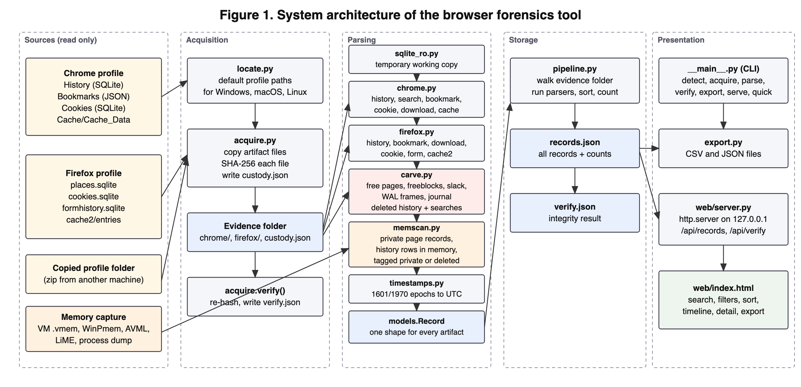{width=6.5in}

The tool has five layers. Sources are never modified. Acquisition copies and hashes files into an evidence folder. Parsing turns each file into records through a temporary working copy. Storage is a single `records.json` plus the custody and verification logs. Presentation is a command line, export writers and a local web page.

## 4.2 Data flow

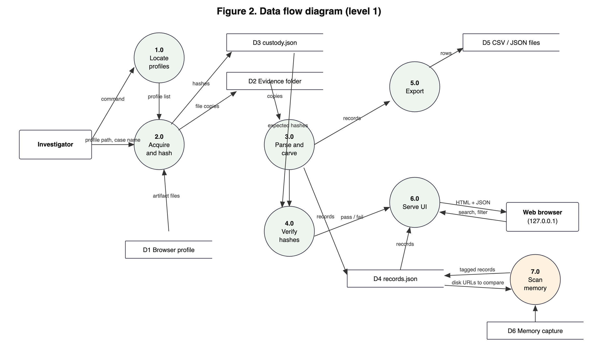{width=6.5in}

## 4.3 Sequence of a run

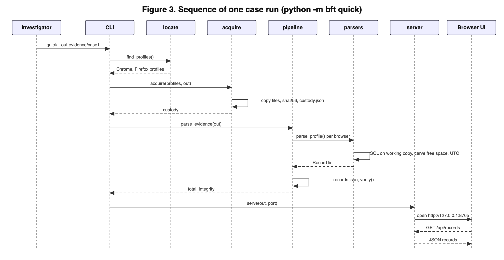{width=6.5in}

## 4.4 Record schema

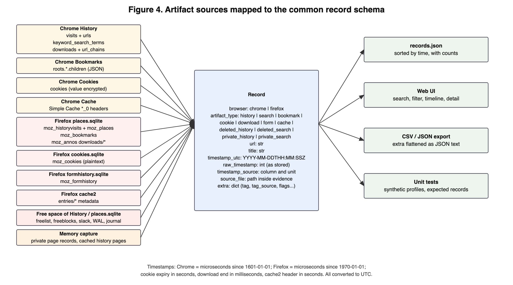{width=6.5in}

Every artifact, live or recovered, becomes a `Record` with nine fields: browser, artifact type, URL, title, UTC timestamp, raw timestamp, timestamp source (table, column and unit), source file, and an `extra` dictionary for artifact-specific values such as the visit transition type, bookmark folder, cookie flags or download size.

# 5. Implementation

The code is organised as a Python package `bft` with one module per responsibility. Figures 5 to 22 show the key parts of each module.

## 5.1 Record model and timestamps

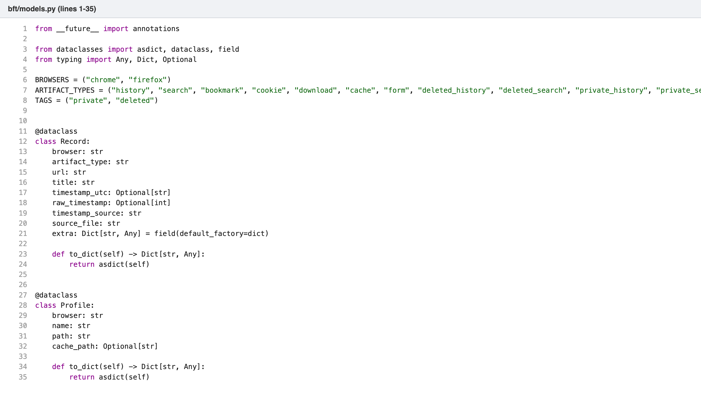{width=6.5in}

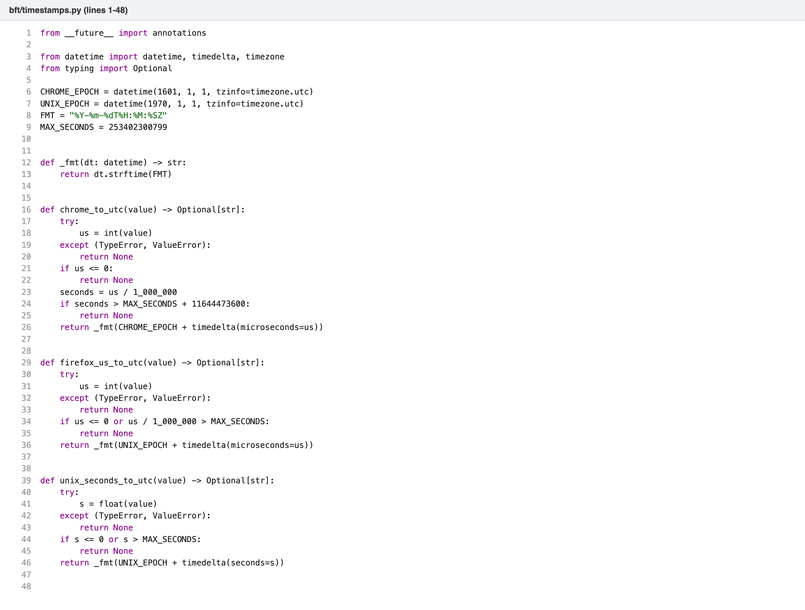{width=6.5in}

Each converter rejects zero, negative, non-numeric and out-of-range values and returns `None`, so a missing or corrupt timestamp never crashes the parser or produces a false date.

## 5.2 Acquisition and integrity

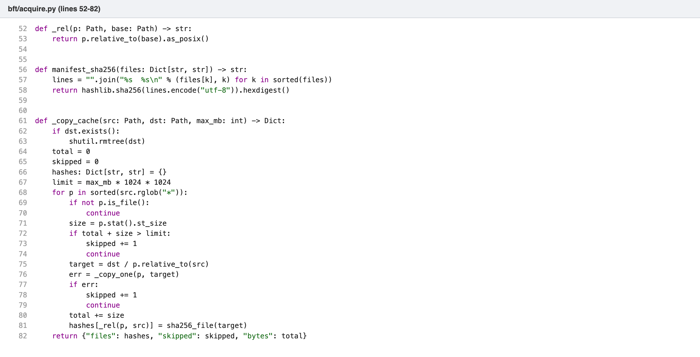{width=6.5in}

The custody log records the case name, host, user, operating system, Python version and, for each file, its relative path in the evidence folder, its source path, its SHA-256, size and modification time. A second acquisition into the same folder (for example Chrome first, then Firefox) merges into the existing log instead of replacing it. Cache folders hold many small files, so each cache folder's entry lists a SHA-256 for every file in it and one hash over that whole list. Verification re-hashes every listed file and reports a changed, missing or added file by name, and the list hash catches a hash list in `custody.json` that was edited to match a changed file. Acquiring the same profile again replaces the earlier cache copy, so no leftover file from an older copy can hide among the new ones.

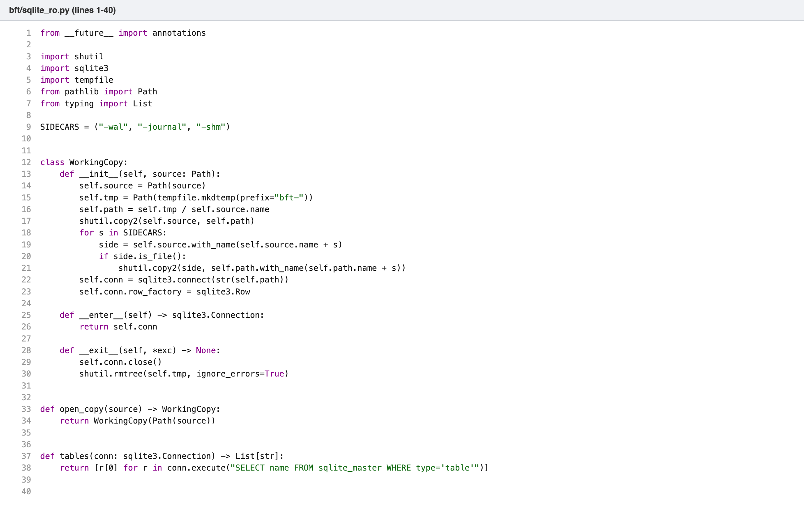{width=6.5in}

## 5.3 Chrome parsers

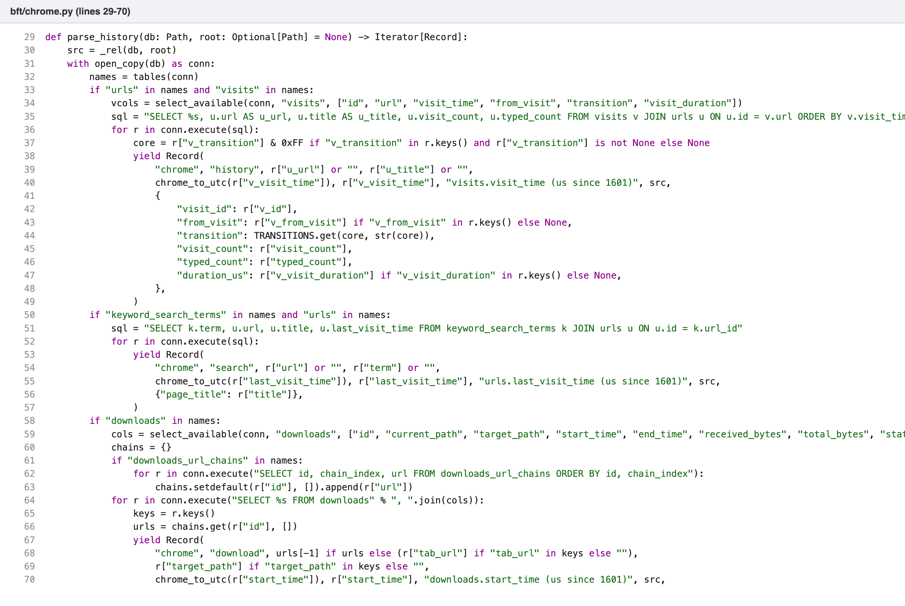{width=6.5in}

Columns are discovered at run time with `PRAGMA table_info`, so a column that is missing in an older or newer Chrome version is skipped rather than causing an error. The visit transition value is masked to its low byte and translated to a name (typed, link, reload, form submit and so on).

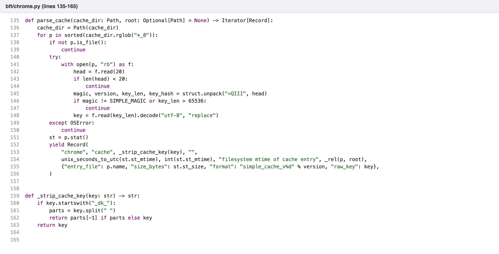{width=6.5in}

## 5.4 Firefox parsers

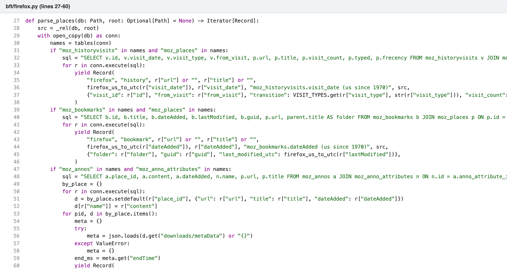{width=6.5in}

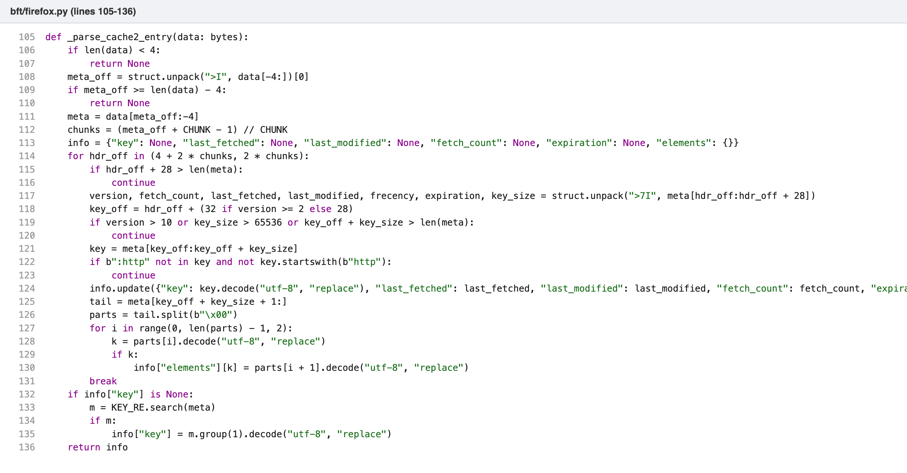{width=6.5in}

The cache2 format stores its metadata at the end of each entry file, with the offset in the final four bytes. The parser reads the header fields in network byte order, validates the key, and falls back to a regular expression search for the URL if the header does not match.

## 5.5 Recovering deleted history

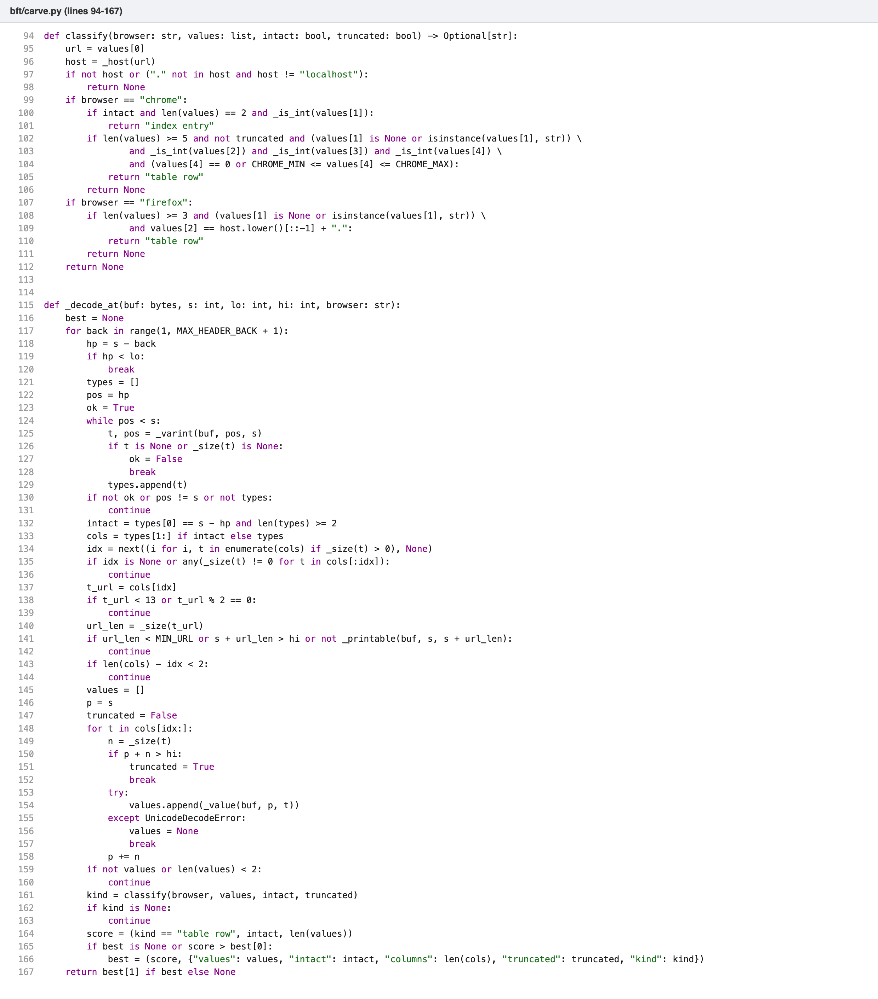{width=6.5in}

For every `http(s)://` found in free space, the carver searches up to 40 bytes backwards for a SQLite record header: a run of varints whose serial types describe columns ending exactly where the URL begins, with the URL column's length taken from its serial type. This is how the URL is separated from the title that follows it with no delimiter. Each candidate must then match the real table layout. A Chrome `urls` row needs a title, two counters and a timestamp between 2000 and 2100. A Chrome `urls_url_index` entry needs a URL and a row id. A Firefox `moz_places` row needs its reversed-host column to equal the URL's host reversed. Records whose URL is still in the live table are dropped.

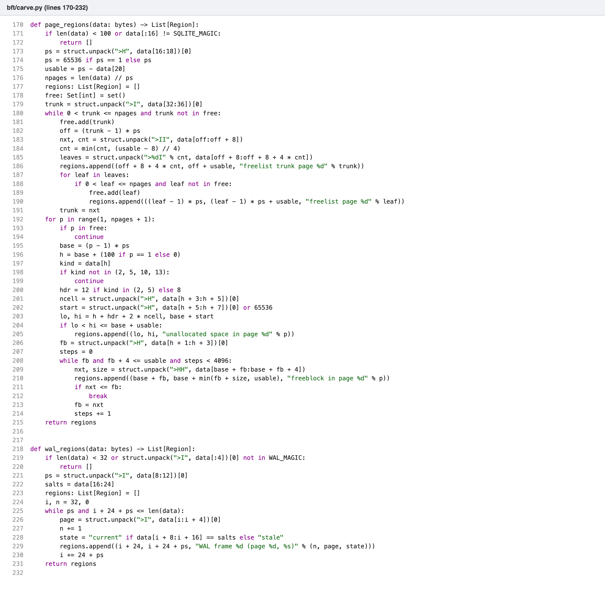{width=6.5in}

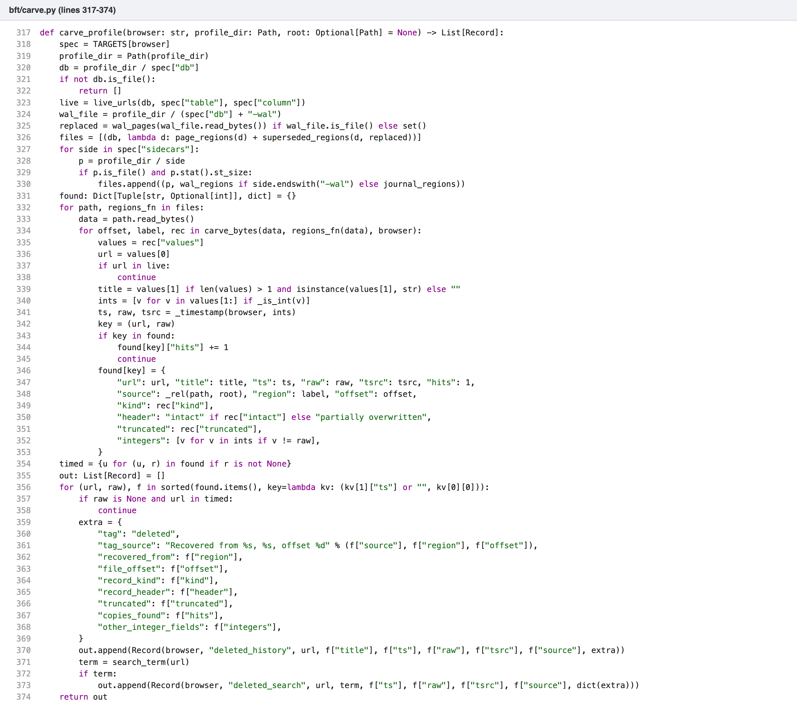{width=6.5in}

## 5.6 Browser artifacts in memory

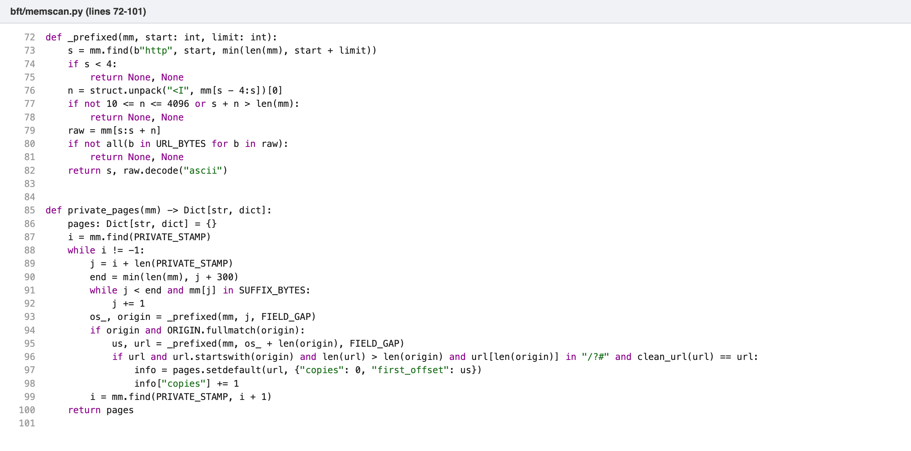{width=6.5in}

The scanner opens the capture as a memory map, so a multi-gigabyte image is never loaded into RAM, and looks for two kinds of evidence. The first is Firefox's private-window page record. At every `^privateBrowsingId=1` it skips the rest of the origin attributes and reads the next two fields by the 4-byte length in front of each: an origin such as `https://example.org`, then a page address. The page is accepted only if it starts with that origin followed by `/`, `?` or `#`, and only if both fields sit within 24 bytes of what comes before them. Reading by length means bytes left over from an earlier string after the address are never taken as part of it. The second kind is a SQLite history row held in the operating system's file cache: at every URL the carver's record decoder is tried, which gives back the URL, title and timestamp and identifies the browser.

Every other URL string, in 8-bit and UTF-16 text, is collected only for the audit file. The host must be a valid name, certificate and schema URLs are dropped as noise, and a few characters of leftover bytes after a much more common URL are folded into it.

{width=6.5in}

Private pages become `private_history` records, and `private_search` when the URL is a search. History rows become `deleted_history` and `deleted_search` records. Each carries a `tag` and a `tag_source`, the sentence shown when the examiner hovers over the tag. No other record mentions memory. The SHA-256 of the image is recorded in the custody log. The page records, the history rows and the audit list are written to `memory/<image>.json`, and the tags are worked out when records are merged, so acquiring the profile before or after the scan gives the same result.

## 5.7 Pipeline, command line and interface

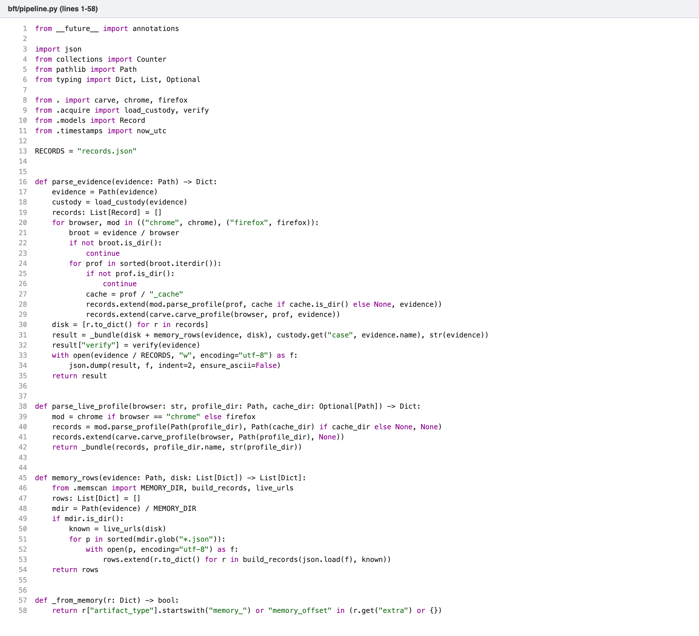{width=6.5in}

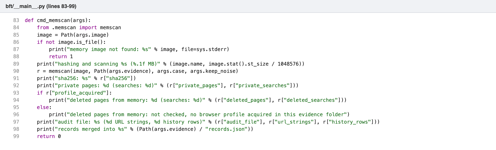{width=6.5in}

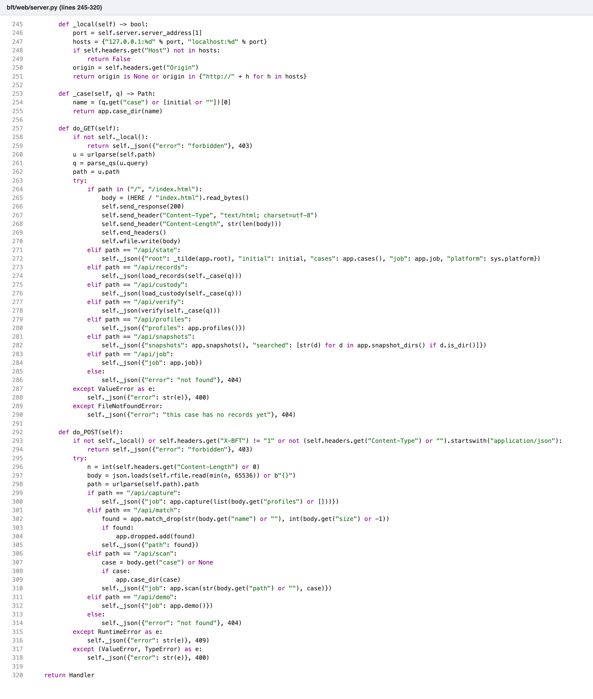{width=6.5in}

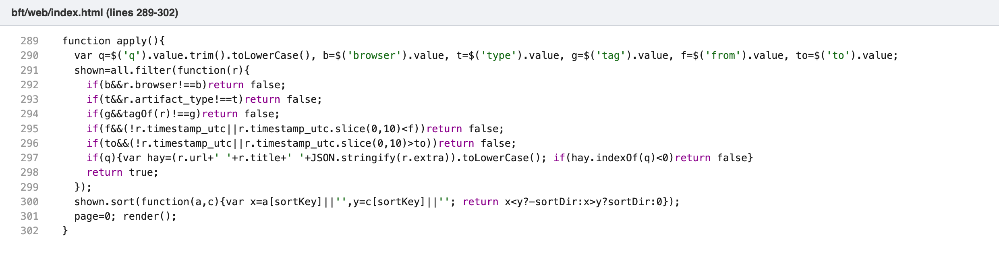{width=6.5in}

The web server binds to 127.0.0.1 only. The page loads all records once and filters them in the browser, which keeps search instant even for tens of thousands of rows. Deleted and private records show a small tag next to their type; hovering over it, or moving keyboard focus to it, opens a tooltip with the evidence, positioned so it stays inside the window.

The tool opens on a home screen with three actions. **Capture the browser** shows what not to do first (do not close the browser or its tabs; take a memory snapshot first if private windows matter), lists the profiles found on the computer, and copies, hashes and parses them into a new case named by date and time. **Memory snapshot** gives the VMware menu steps, lists the snapshot memory files found in the usual VMware folders with a Scan button, and accepts a dropped file. A browser never tells a page where a dropped file is stored, so the tool finds the file with the same name and size on disk and scans it where it is instead of uploading gigabytes. Long tasks run in the background and the page shows each step.

Because these buttons make the tool act, the server checks every request. It must be addressed to 127.0.0.1 or localhost on the tool's own port, and an action must carry a custom header and a JSON body, which another website cannot send. Capture only accepts profiles the tool found itself, and scan only accepts memory files it found or matched. Without these checks, any web page open in the same browser could start a capture or read the records. The tool opens in its own window using pywebview, which is bundled into the Windows `.exe` built by GitHub Actions; the tool itself still uses only the standard library, and without pywebview it opens in the default browser.

## 5.8 Tests

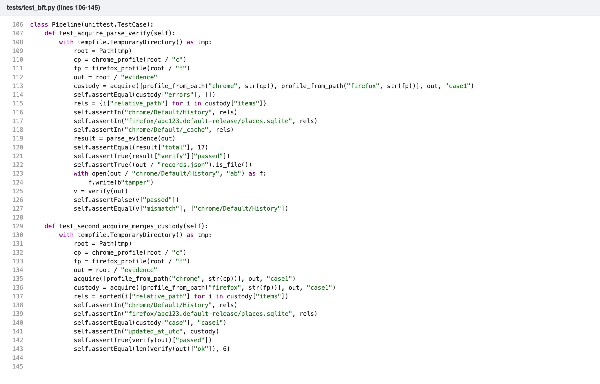{width=6.5in}

# 6. Testing and results

## 6.1 Unit tests

Synthetic Chrome and Firefox profiles are built in a temporary folder with the real table layouts and known values. The tests check record counts per artifact type, specific timestamp conversions, bookmark folder paths, encrypted versus plaintext cookie handling, download states and cache entry decoding. A pipeline test acquires both profiles, parses them, confirms the hash check passes, then appends bytes to one evidence file and confirms the hash check fails and names the file. Cache tests change one cache file, delete another and plant a third, and check that each is reported by name; rewrite a hash in `custody.json` to match a changed file and check the list hash catches it; acquire twice and check no leftover file remains; and check that a case acquired by an older version reports its cache as not hashed instead of passing silently.

The carving tests build databases, delete known rows, and check that exactly those URLs come back with the right titles and timestamps, and that no live URL is reported as deleted. Separate tests cover recovery from WAL frames, recovery from main-file pages superseded by the WAL, the effect of secure delete, and search-term extraction for Google, Bing, DuckDuckGo, YouTube and Yahoo.

The memory tests build a synthetic capture holding Firefox private page records with leftover bytes after the address, a script carrying the private stamp outside a page record, plain URL strings in both encodings, certificate and schema noise, and a real Firefox history page. They check that only the pages are tagged private, that the script and plain strings stay out of the records but are in the audit file, that only history rows missing from the same browser's live history are tagged deleted, that a bookmark does not count as history, that nothing is tagged deleted without an acquired profile, that acquiring before or after the scan gives the same records, and that neither the image nor the evidence changes. Separate tests feed page records with a third-party address, a look-alike host and fields too far apart, and each rule of the page-record check was broken on purpose to confirm a test then fails.

The interface tests start the server on a temporary folder. They check that requests addressed to another host, actions from another website, actions without the tool's header, and case names that try to leave the evidence folder are all refused; that a capture copies only a profile the tool found and parses it; that a snapshot is found and scanned in place without copying; that a dropped file is matched by name and size; and that the demo case is built inside the running process, as it must be in the `.exe`, where there is no separate Python to call. Each check was removed on purpose to confirm a test fails.

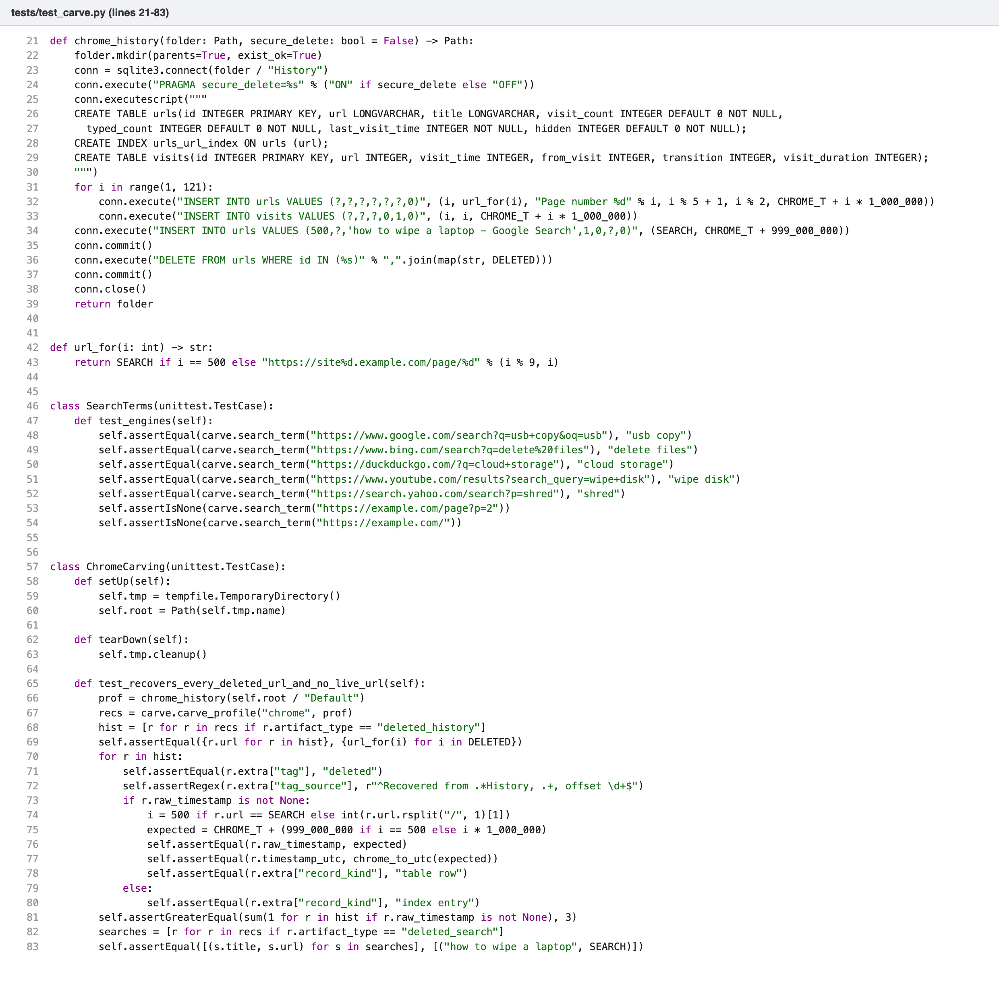{width=6.5in}

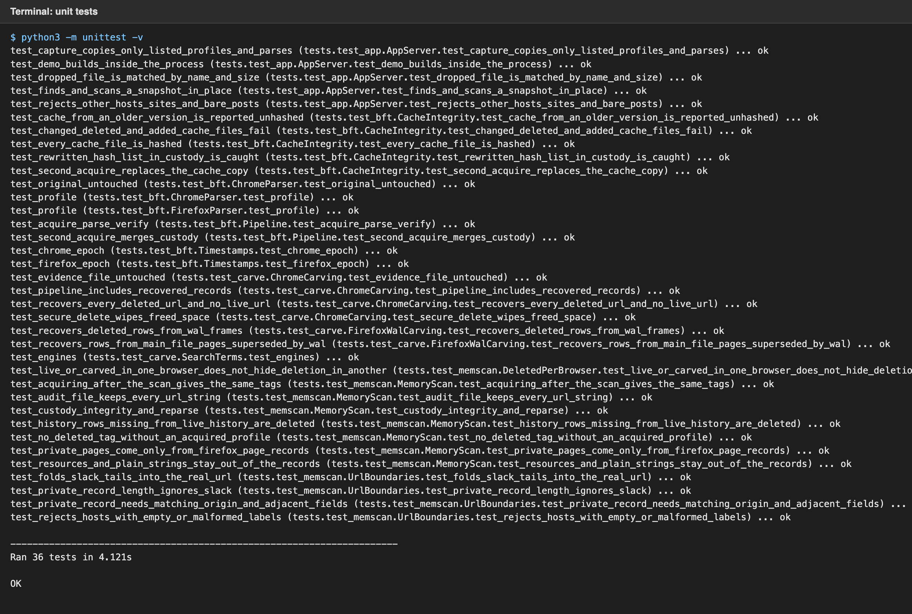{width=6.5in}

## 6.2 Command line

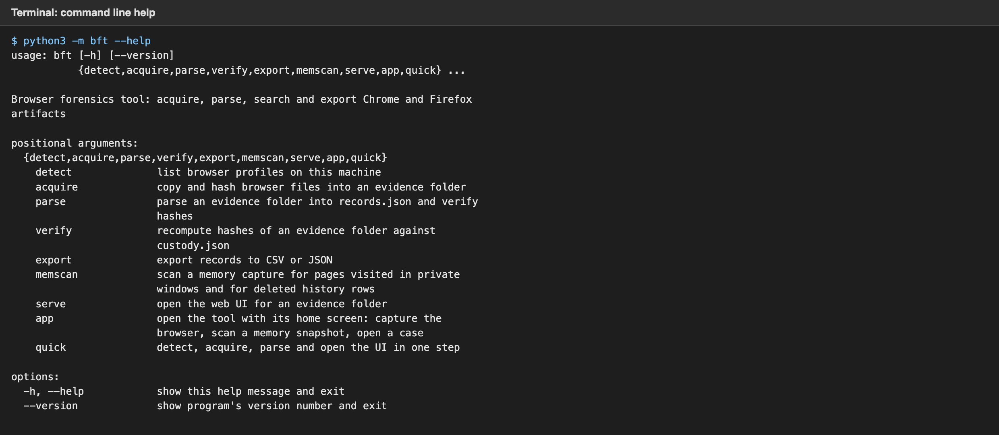{width=6.5in}

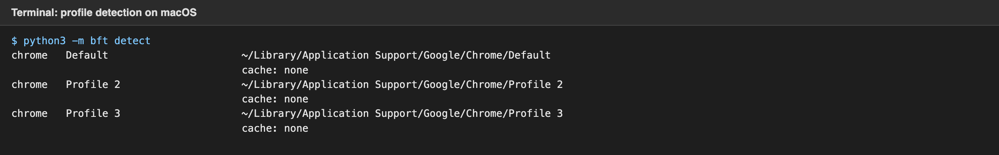{width=6.5in}

## 6.3 Demo case

A fictional scenario was generated with `tools/make_demo_evidence.py` so the demonstration does not expose anyone's real browsing. The generator writes real SQLite databases, a bookmarks file, cookie databases and cache entries for both browsers, covering three days of activity by a fictional employee. On the last morning the employee searches "how to clear browser history" and then deletes the incriminating entries from both browsers. They do not clear the cache, cookies, bookmarks or download list. Chrome's database is written with secure delete on, matching the behaviour measured on a real Chrome in section 6.6. Firefox's is written in WAL mode, as real Firefox is. After the cleanup the employee opens a Firefox private window, searches for an anonymous email service, composes and sends a message, searches whether private browsing leaves traces, and closes the tabs. The investigator arrives with the blank private window still open and captures RAM. The generator writes that capture as a raw memory image holding the private session's page records as Firefox keeps them, scripts and images those pages loaded, the same URLs as plain 8-bit and UTF-16 strings and HTTP request lines, pages of Chrome's `History` file cached from before the history was cleared, Firefox history pages from the file cache, ordinary history URLs, and system noise. The evidence set is deterministic, so both team members demonstrate from identical data.

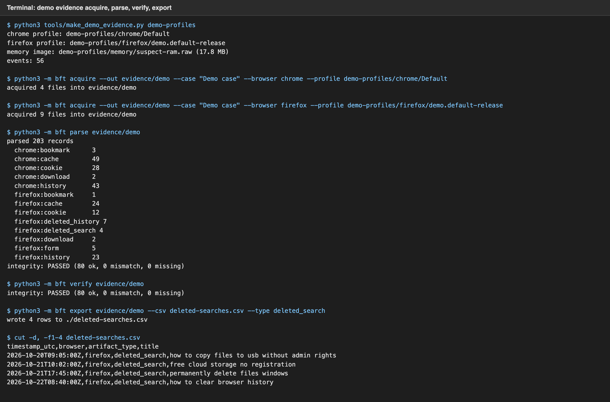{width=6.5in}

{width=6.5in}

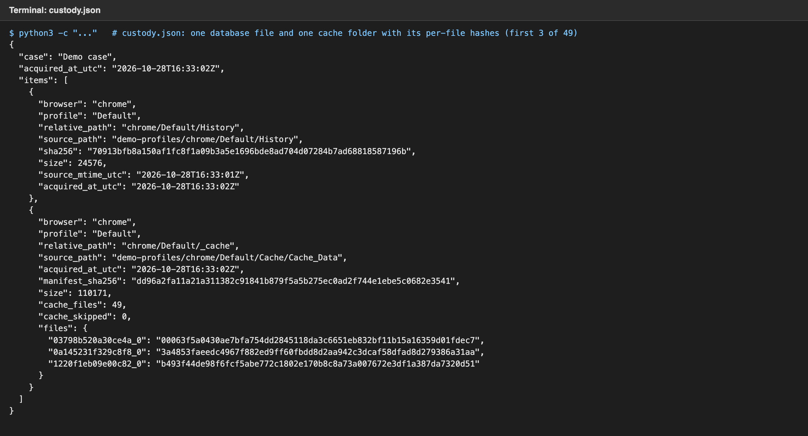{width=6.5in}

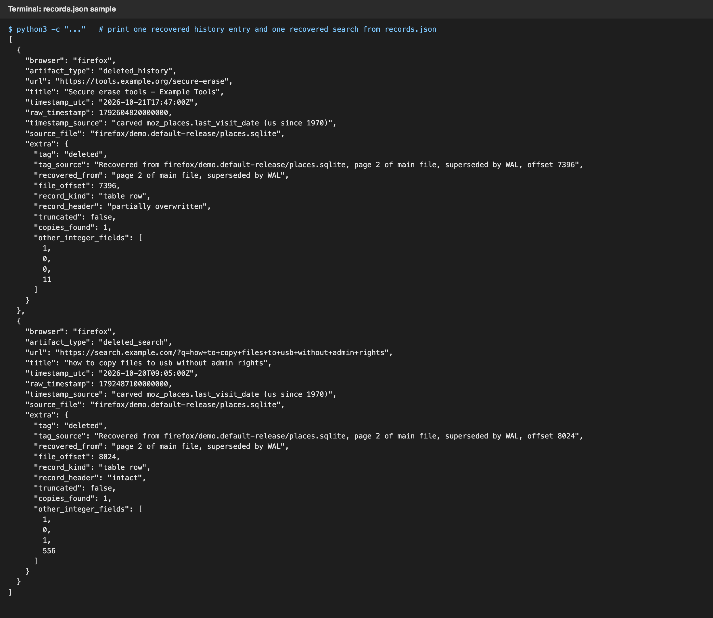{width=6.5in}

## 6.4 The interface

{width=6.5in}

{width=6.5in}

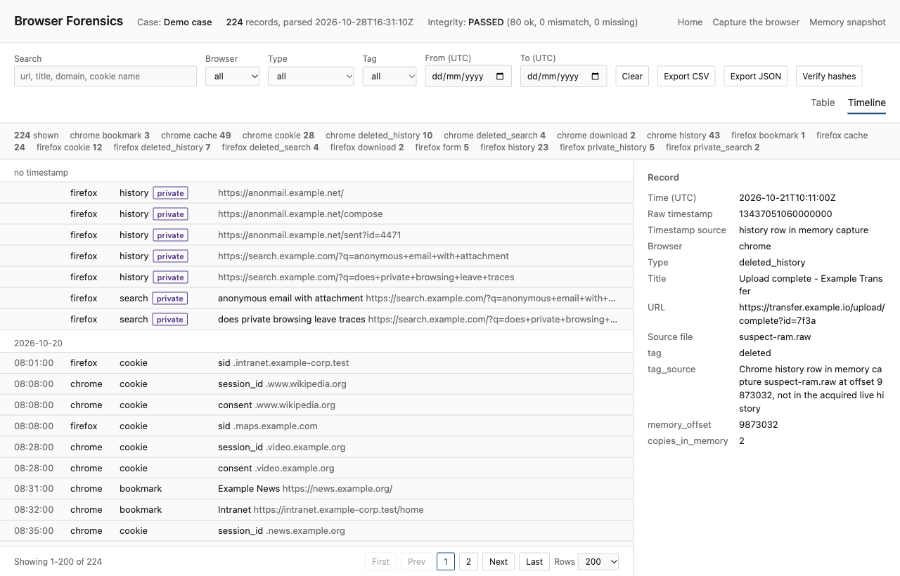{width=6.5in}

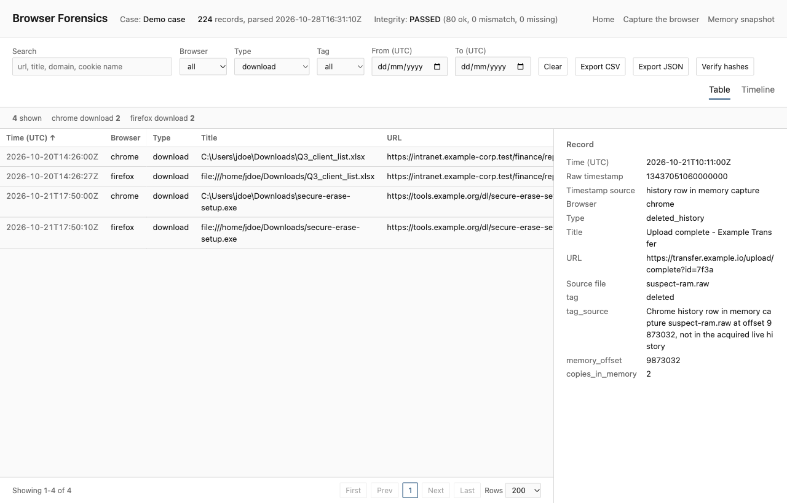{width=6.5in}

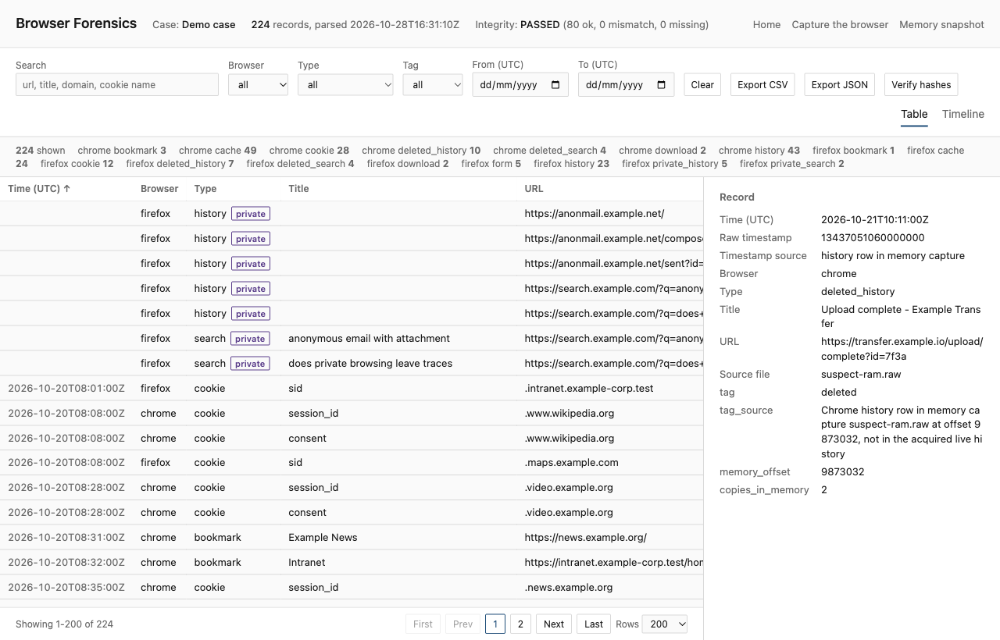{width=6.5in}

{width=6.5in}

{width=6.5in}

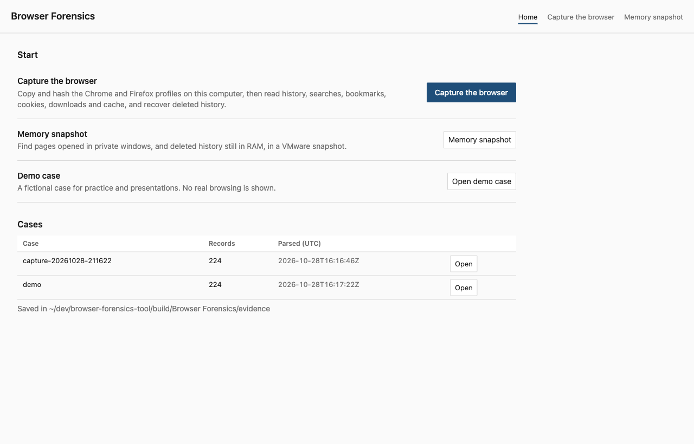{width=6.5in}

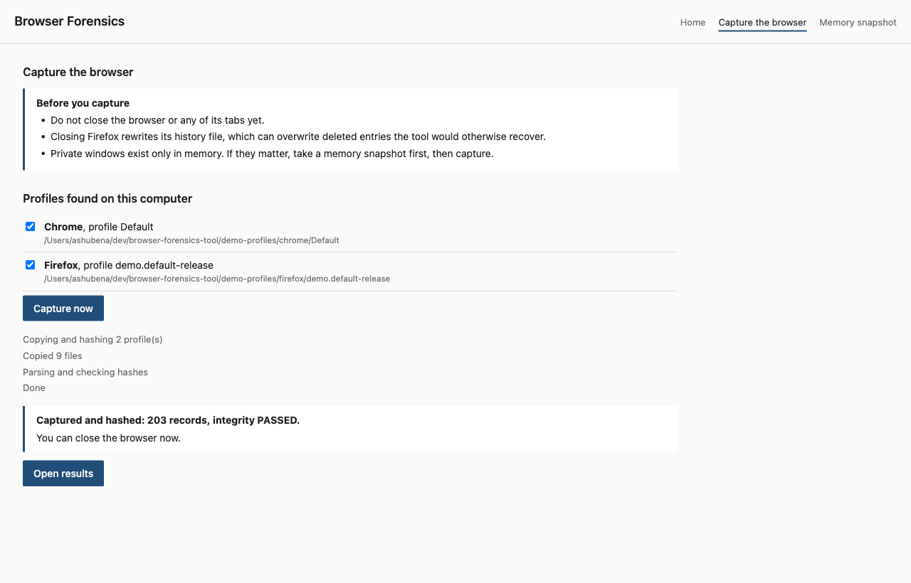{width=6.5in}

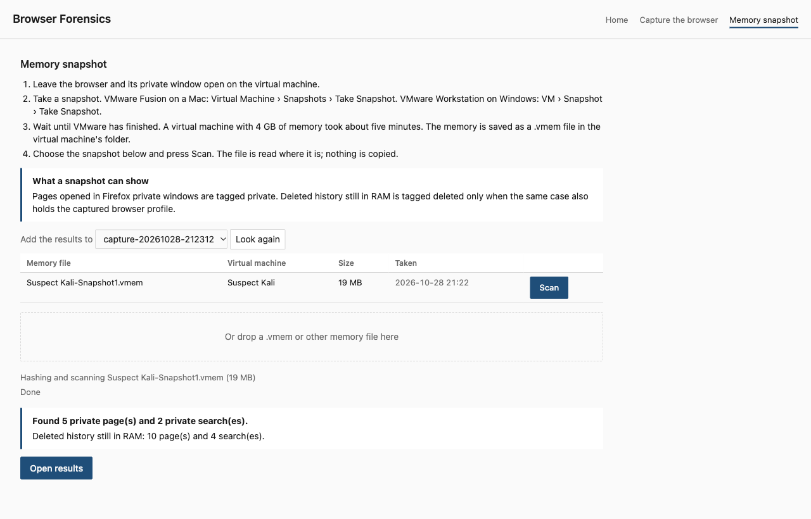{width=6.5in}

## 6.5 Reconstructing the demo case

Chrome's history now shows nothing of the incident: the entries were deleted and Chrome's secure delete wiped them from the file. The tool still reconstructs every step from what the suspect did not think to clear, and from what was still in RAM (all times UTC):

| Time | Step | Evidence that survived |
|---|---|---|
| 20 Oct 09:05 | search "how to copy files to usb without admin rights" | Firefox deleted search, carved; Chrome deleted search, history row in RAM |
| 20 Oct 09:07 | visit to a Q&A page on copying to USB | Chrome cache entry; Chrome deleted history, row in RAM |
| 20 Oct 14:20 | visit to the intranet finance reports page | Chrome cache entry; Chrome deleted history, row in RAM |
| 20 Oct 14:26 | download of `Q3_client_list.xlsx` | Chrome and Firefox download records |
| 21 Oct 10:02 | search "free cloud storage no registration" | Firefox deleted search, carved; Chrome deleted search, row in RAM |
| 21 Oct 10:04 | first visit to the file transfer site | Chrome deleted history, row in RAM; cache entries |
| 21 Oct 10:11 | "Upload complete" page on the transfer site | Firefox deleted history, carved; Chrome deleted history, row in RAM; cache entries |
| 21 Oct 10:12 | transfer site bookmarked | Chrome and Firefox bookmarks |
| 21 Oct 17:45 | search "permanently delete files windows" | Firefox deleted search, carved; Chrome deleted search, row in RAM |
| 21 Oct 17:47 | visit to a secure erase tools page | Firefox deleted history, carved; Chrome deleted history, row in RAM; cache entries |
| 21 Oct 17:50 | download of `secure-erase-setup.exe` | Chrome and Firefox download records |
| 22 Oct 08:40 | search "how to clear browser history" | Firefox deleted search, carved; Chrome deleted search, row in RAM |
| 22 Oct 08:41 | visit to a help page on clearing browsing data | Firefox deleted history, carved; Chrome deleted history, row in RAM; cache entries |
| after 08:41, time unknown | private window: search "anonymous email with attachment" | `private`: Firefox page record in RAM |
| after 08:41, time unknown | anonymous mail service: home, compose, sent message 4471 | `private`: Firefox page records in RAM |
| after 08:41, time unknown | private window: search "does private browsing leave traces" | `private`: Firefox page record in RAM |

The memory scan adds two things. It finds the private session, which left nothing on disk; those records have no time, because private pages are never written to history, and the table orders them only by what is known: they were in memory at capture. It also recovers Chrome's deleted history, all ten pages and four searches, with titles and timestamps, from pages of the `History` file that were still in the operating system's file cache from before the clear. Secure delete wiped those rows from the file on disk but not from RAM. The scripts and images the private pages loaded, and the 56 plain URL strings in the capture, are not shown; they are in the audit file.

Two points matter for the analysis. First, the gap itself is evidence: cache entries, cookies and a bookmark for the transfer site exist with no matching history, which shows the history was selectively deleted. Second, the recovered search "how to clear browser history" followed by the deletion shows intent to conceal. Each row can be traced back to a named file, region and byte offset through the detail panel, which is the kind of activity reconstruction the Windows Forensics lecture describes.

## 6.6 Run on a real profile

The tool was run on a real Chrome profile on macOS. It acquired 35 files, parsed 45,997 records (41,334 history visits, 408 searches, 262 bookmarks, 3,721 cookies, 272 downloads) and the hash verification passed. Timestamps ranged from 2010 (imported bookmarks) to the day of the run, which is consistent with the browser's own history page. Two records had no timestamp; both were bookmarks with no `date_added` value. The real profile is not shown in this report for privacy.

The carver recovered nothing from this profile, and the measurements explain why. The browser was Chrome 156.0.8078.48 on macOS 26.2.

| Profile | Live URLs | Free pages | Free pages zeroed | URL strings left in slack space | Of those, matching nothing live |
|---|---|---|---|---|---|
| Default | 391 | 391 | 390 | 2 | 1 |
| Profile 2 | 13,834 | 2 | 1 | 191 | 2 |
| Profile 3 | 424 | 138 | 137 | 3 | 3 |

Almost every freed page was zeroed, and no freeblock contained a URL, which indicates that this Chrome build deletes with SQLite's secure delete on (an inference from the bytes, not from Chrome's source). The URL strings left in slack space were traced to the table that owns each page. Nearly all are older copies of values that are still live in another table (`clusters_and_visits`, the URL index, `visited_links`), so they are not deleted history. The few that match nothing live are fragments without a decodable record header, so the carver correctly does not report them. The conclusion for an investigator: on current Chrome, deleted history is rarely recoverable from the History file itself, and the cache, cookies, bookmarks, downloads and other browsers are where the traces survive.

## 6.7 Defects found during testing

Acquiring Chrome and then Firefox into the same evidence folder originally overwrote `custody.json`, so the Chrome files lost their hash records and verification reported only three files. The fix merges a new acquisition into the existing log, stamps each item with its own acquisition time, and a regression test (`test_second_acquire_merges_custody`) now covers it.

Two more defects were found while building the carver:

- **False positives from damaged headers.** The first version accepted any byte run in front of a URL that decoded as a plausible length, and produced fragments such as `https://site4.exa` from index entries whose headers had been overwritten. The fix checks every candidate against the real table layout before accepting it. The test `test_recovers_every_deleted_url_and_no_live_url` now requires that exactly the deleted URLs are reported.
- **Missed rows in superseded pages.** After Firefox checkpoints its WAL and then deletes rows, the only copy of the deleted rows is the old page in the main file, which a newer WAL frame replaces. The first version scanned only the free areas of the main file and missed it. The fix scans every main-file page that the WAL supersedes, covered by `test_recovers_rows_from_main_file_pages_superseded_by_wal`.

- **Private searches hidden by a cookie.** The first memory scanner labelled a URL "in cache or cookies only" whenever the site had a cookie on disk, so the two private searches in the demo were hidden under a weaker label. A cookie for a site says nothing about a specific page. That fix was later superseded by the tag design below.

The real capture from the Kali VM (section 6.9) found five more defects in the memory scanner:

- **URLs running past their end.** Firefox keeps some URLs in fixed-size slots with the length stored elsewhere, so the bytes after the real end are leftovers from an earlier string. One test URL came out as seven variants such as `...4471refox-`. Page records are now read by their stored length, and in the audit list a variant of up to 8 characters is folded into a URL with at least ten times as many copies, unless the shorter URL ends at `/`, `?`, `#`, `&` or `=`. The first version of that rule also folded `/docs/arm/` into `/docs/`; the regression test caught it.
- **Junk accepted as URLs.** `http://.css` passed the host check. Hosts must now be valid names. The 142 strings this removed were checked by hand: 128 Firefox wildcard patterns, 7 template placeholders and 7 malformed strings.
- **A label claiming a check that never ran.** Without an acquired profile every URL was labelled "memory only", including a normal-window page that was in Kali's disk history. The labels were replaced by the `private` and `deleted` tags, and `deleted` from memory now requires the profile.
- **Browsers pooled.** A URL carved from Firefox hid the same URL's deleted row in Chrome, so the demo recovered 2 of Chrome's 10 deleted pages from RAM. The live and carved sets are now kept per browser, covered by `test_live_or_carved_in_one_browser_does_not_hide_deletion_in_another`.
- **A bookmark counted as history.** The transfer site's history entry was deleted but its bookmark survived, so the row was not tagged. Only history and search records now count as live history.

The page-record tests first passed with each rule removed, because one check was masking another. They were extended until breaking any single rule fails a test.

A review of what the hash check covers found a defect in the first version of acquisition: cache folders were copied but given no hash at all, and verification skipped any entry without one. The 73 cache records in the demo case therefore rested on files whose integrity was never checked, while the header still said PASSED. Every cache file is now hashed and verified, as described in section 5.2, and cases acquired before the fix list their cache folders as not hashed.

Building the home screen found one more defect, older than the interface work. The server class used by every version so far read the current working folder on each request, although it never served files from it. Started from a folder it could not read, every request failed with an empty response. The handler now uses the plain request class, which does not touch the working folder.

One case cannot be fixed: in the Chrome-style test, two of the five deleted rows survived only as index entries (URL without time), because SQLite rebalanced their table pages and the old bytes were overwritten. No tool can recover bytes that no longer exist.

## 6.8 Cross-platform status

| Platform | Status |
|---|---|
| macOS (Ayesha) | Verified: unit tests, demo case, real Chrome profile |
| Windows (teammate) | GitHub Actions runs the unit tests on Windows and builds `BrowserForensics.exe` on every push. To be run on the teammate's machine: the `.exe`, the demo case, and real Chrome and Firefox profiles (see `WINDOWS.md`) |
| Kali Linux (VMware, both) | Memory capture done (section 6.9). Still to be run inside Kali: unit tests, demo case, comparison with Hindsight and dumpzilla, and bulk_extractor on the same capture |

## 6.9 Real memory capture from a Kali VM

The Kali Linux VM (ARM, 4 GiB RAM, Firefox) was used as the suspect machine. In a normal window `https://www.kali.org/docs/` was opened as a control. In a private window a DuckDuckGo search for `bft private test seventeen`, the Wikipedia article on volatile memory and `https://example.org/?bft=private-test-4471` were opened, then those tabs were closed, leaving the blank private window open. VMware Fusion took a snapshot from the host with `vmrun`, which took 5 minutes 20 seconds and wrote the RAM to `Kali Linux-Snapshot1.vmem` (4 GiB, 2.5 GB on disk because empty pages are not stored). `bft memscan` hashed and scanned it in about two minutes on the Mac.

| Check | Result |
|---|---|
| Private stamp next to the test URL | example.org marker: 11 of 128 copies; Wikipedia article: 43 of 439; normal-window control: 0 |
| Private pages (page records) | 16 pages and 1 search. On the test sites: the Wikipedia article and Wikipedia's home page, the example.org marker and example.org's home page, and kali.org's home page. No script, image, stylesheet or tracking call |
| Other private pages | 11 pages and 1 search, from earlier private browsing on the VM; not listed, for privacy |
| URL strings in the capture | about 11,900, kept in the audit file only |
| Search phrase | Not found anywhere in the 4 GiB in ASCII or UTF-16, with spaces, `+` or `%20`, and no DuckDuckGo results address. The kernel's boot options do not turn on zeroing of freed memory, and no compressed swap device was found in RAM |
| Same strings on the VM's disk | A raw scan of both virtual disk files found none of the private test URLs and not the search phrase |

The page records separated the pages opened in the private window from the resources they loaded. Those resources carry the private stamp hundreds of times elsewhere in the capture, but none appeared in a page record. The private pages left nothing on the VM's disk, which matches how private mode is designed. The missing search is unexplained. The test grep ran outside the tool, so no tool could have found it in this image. The most likely explanation is that the search tab's memory was freed and reused before the capture, but that is an inference.

Two things are not yet proven. The home pages of Wikipedia, example.org and kali.org may have been opened on the way to the test pages, or may be redirect steps; only a written list of what was opened can settle it. And the record format was identified on one Firefox version on ARM Linux. A second capture, with the search results tab left open and a written list of every page opened, is the planned validation: the tool must return exactly that list.

# 7. Limitations

- Chrome cookie values are encrypted by the operating system (DPAPI on Windows, Keychain on macOS). The tool reports the host, name, path, flags and timestamps and marks the value as encrypted; it does not decrypt.
- Cache parsing reads entry headers and metadata (URL, size, times, response status), not the cached content. Chrome's older blockfile cache layout is not parsed.
- Deleted-record recovery is opportunistic. It fails when the browser uses secure delete (current Chrome on macOS, as measured), when SQLite has rebalanced the page, or when the WAL has been checkpointed and overwritten. Index entries give the URL without a time. Only the history databases are carved; cookies, form history and the cache are not.
- Private and incognito sessions are never written to the profile. The memory scanner finds them only in a capture taken while the machine is on, and only what has not been overwritten. The `private` tag relies on a Firefox page record identified from the bytes of one capture (Firefox on ARM Linux), not from Firefox's source; Chrome's incognito pages are never tagged. Private pages have no timestamp. `deleted` from memory needs the browser profile in the same evidence folder, and only history rows count, not loose URL strings. Records are not attributed to a process; that would need Volatility with the right symbol tables, which are hard to build for an ARM Linux VM. Hibernation files on Windows 8 and later are compressed, so scanning `hiberfil.sys` directly finds little.
- The tool does not acquire RAM. A capture tool or VM snapshot must provide the image. The snapshot page finds VMware `.vmem` files in the usual VMware folders; a dropped file is found only if it sits in the VMware, Desktop, Downloads or Documents folders.
- `BrowserForensics.exe` is not code-signed, so Windows SmartScreen warns on first run (More info, then Run anyway) and some antivirus products flag programs packed with PyInstaller. On macOS the packaged app asks for access to the Documents folder, where it keeps its cases.
- Session restore, saved passwords and autofill data are copied for completeness but not parsed.
- Acquiring from a running browser depends on the operating system allowing the copy. On Windows, Chrome must be closed first; the tool reports the locked file instead of failing silently.
- Firefox parsing has been validated on synthetic profiles and the generated demo set; validation on a real Firefox profile is pending the Windows and Kali runs.

# 8. Conclusion and future work

The tool meets the three tasks in the brief (locate and access the data, display it in a structured interface, search and filter it) and adds the evidence handling the course emphasises: hashed acquisition, read-only parsing, explicit timestamp provenance and a merged timeline. Building it in stages with an agreed record schema let two people work on different browsers without blocking each other.

The added carver shows the difference between reading a database and examining it: on the demo case, Chrome's history alone shows nothing, while the carved Firefox records, the cache and the bookmarks reconstruct the whole incident, and the memory scan adds the private session that never touched the disk and the Chrome history that secure delete had already wiped from it.

Future work: Edge and Chromium-based browsers (same format as Chrome, only the paths differ), Safari, cookie decryption when the examiner has the user's keys, carving the cookie and form history databases, an automatic "history gap" report listing sites present in cache or cookies but absent from history, keyword lists for flagging search terms of interest, and process attribution of memory hits with Volatility.

# References

1. Course lecture slides: File Systems (L07), Windows Forensics (L09), E-mail and Social Media Investigations (L13).
2. SQLite Consortium, "SQLite Documentation", https://sqlite.org/docs.html
3. The Chromium Projects, "User Data Directory", https://chromium.googlesource.com/chromium/src/+/HEAD/docs/user_data_dir.md
4. Mozilla, "Profiles: Where Firefox stores your bookmarks, passwords and other user data", https://support.mozilla.org/kb/profiles-where-firefox-stores-user-data
5. Obsidian Forensics, Hindsight (Chrome history forensics), https://github.com/obsidianforensics/hindsight
6. Busindre, dumpzilla (Firefox forensics), https://github.com/Busindre/dumpzilla
7. Python Software Foundation, "sqlite3", "hashlib", "http.server" module documentation, https://docs.python.org/3/library/
8. SQLite Consortium, "Database File Format" and "Write-Ahead Logging", https://sqlite.org/fileformat2.html and https://sqlite.org/wal.html
9. Brezinski, D. and Killalea, T., "Guidelines for Evidence Collection and Archiving", RFC 3227, IETF, 2002
10. Garfinkel, S., bulk_extractor, https://github.com/simsong/bulk_extractor

# Appendix A. How to run

Without the command line:

- Windows: double-click `BrowserForensics.exe`. It is built by GitHub Actions on every push (Actions, Windows app, the latest run, BrowserForensics-windows); `WINDOWS.md` has the full steps.
- From the project folder: double-click `start.command` (macOS, or `./start.command` on Kali) or `start.bat` (Windows), or press F5 or Ctrl+Shift+B in VS Code.

The home screen then offers Capture the browser, Memory snapshot and Open demo case. The same steps by hand:

    python3 -m unittest -v
    python3 -m bft app
    python3 -m bft detect
    python3 -m bft quick --out evidence/case1
    python3 tools/make_demo_evidence.py demo-profiles
    python3 -m bft acquire --out evidence/demo --case "Demo case" --browser chrome --profile demo-profiles/chrome/Default
    python3 -m bft acquire --out evidence/demo --case "Demo case" --browser firefox --profile demo-profiles/firefox/demo.default-release
    python3 -m bft parse evidence/demo
    python3 -m bft memscan demo-profiles/memory/suspect-ram.raw --evidence evidence/demo
    python3 -m bft serve evidence/demo

On Windows replace `python3` with `py`. To build the app yourself: `pip install pyinstaller pywebview`, then `python packaging/build.py`.

# Appendix B. Repository layout

    bft/            the tool (models, timestamps, locate, acquire, sqlite_ro, chrome, firefox, carve, memscan, pipeline, export, __main__, web/)
    tests/          synthetic profile builders and unit tests
    tools/          draw_diagrams.py, make_demo_evidence.py
    start.command   one-click start for macOS and Linux; start.bat for Windows
    .vscode/        Run and Debug configuration and tasks that open the tool
    packaging/      PyInstaller entry point and build script
    .github/        workflow: unit tests on Windows and the BrowserForensics.exe build
    WINDOWS.md      setting the tool up on a Windows machine
    docs/           01-planning.md, 02-architecture.md, 03-report.md, diagrams/, img/
